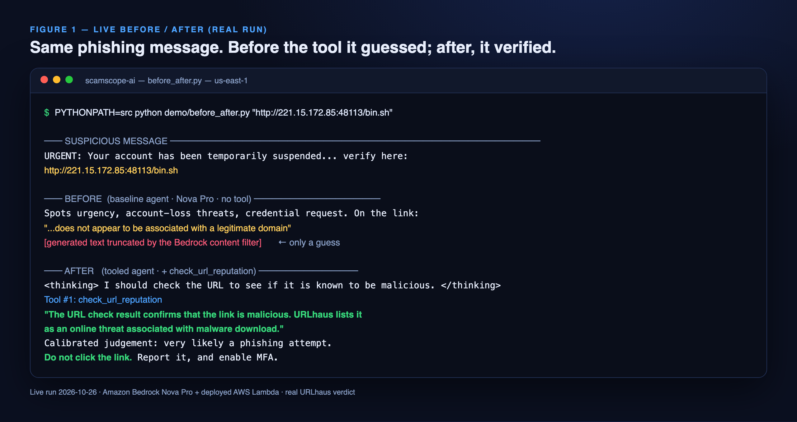
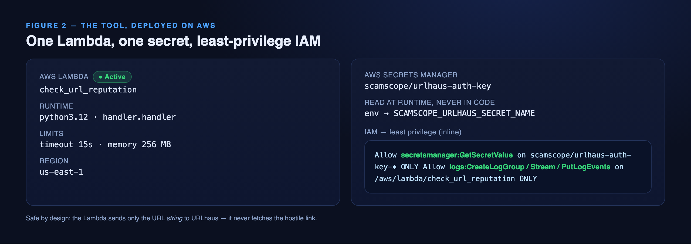
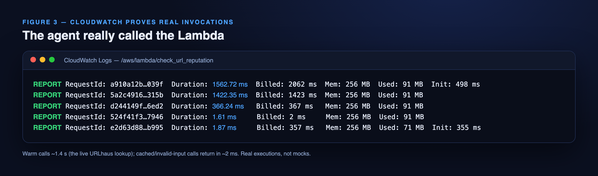

# I gave my phishing-analysis agent one tool — and it stopped guessing about links

*Built for the AWS Builder Center "Give Your Agent a Tool" challenge.*

**Title:** ScamScope — teaching a phishing agent to verify links, not guess
**Tags:** `#give-your-agent-a-tool` `#aws-lambda` `#amazon-bedrock` `#aws-secrets-manager` `#aws-iam` `#amazon-cloudwatch` `#strands-agents` `#amazon-nova`

---

## The agent I started with

ScamScope is a small cybersecurity assistant I built on the **Strands Agents SDK**,
running on **Amazon Bedrock with Amazon Nova Pro**. You paste in a suspicious message
and it explains the phishing warning signs — the urgency, the account-closure threats,
the credential or OTP requests, the look-alike domains, the mismatch between what a link
says and where it goes.

It was genuinely useful at reading *language*. But it had one blind spot that bothered
me: when a message contained a URL, the agent could only reason about **how the link
looked**. It had no way to find out whether the link was actually dangerous. So it
hedged — "this link does not appear to be associated with a legitimate domain…" —
because guessing is all a language model can do about a live URL it cannot inspect.

That is the gap I wanted to close this weekend.

## The one tool I added, and why

I gave ScamScope a single new tool: **`check_url_reputation(url)`**. It checks a URL
against [URLhaus](https://urlhaus.abuse.ch/), a well-known malware-URL threat-intelligence
feed, and returns a structured verdict — `threat_match`, `no_match`, `invalid_input`, or
`lookup_failed` — with the supporting evidence.

I chose URL reputation for three reasons:

1. **It closes the biggest blind spot with ground truth.** A phishing verdict backed by
   a real threat-intelligence match is far stronger than one resting on wording alone.
2. **It is safe by design.** The tool sends only the URL *string* to the lookup API — it
   **never fetches the hostile link** — so it is safe to run against live malware URLs.
3. **It is the most reusable pattern in the domain.** Any agent that handles untrusted
   text — email triage, chat moderation, a SOC assistant — can bolt on the same tool.

## Before and after, on a real message

Here is the heart of it. I ran the *same* phishing message — one carrying a real,
currently-online malware URL pulled straight from the URLhaus feed — through the agent
before and after it had the tool.



**Before**, Nova Pro spotted every social-engineering cue correctly, but on the link
itself it could only speculate — and Amazon Bedrock's content filter even truncated the
answer when it hit the raw malware URL. No verification.

**After**, the agent reasons, then calls `Tool #1: check_url_reputation`. It comes back
and states plainly: *"The URL check result confirms that the link is malicious. URLhaus
lists it as an online threat associated with malware download,"* delivers a calibrated
judgement, and tells the reader **"Do not click the link."** A guess became a verified
fact.

## How it is wired, on AWS

The tool is an **AWS Lambda** function. The Strands `@tool` wrapper invokes it with
`boto3` and relays its structured JSON — the agent never talks to URLhaus directly.



- **AWS Lambda** `check_url_reputation` — Python 3.12, 15-second timeout, 256 MB.
- **AWS Secrets Manager** holds the URLhaus Auth-Key. The Lambda reads it at runtime; it
  is never in code, env files, or the repo.
- **AWS IAM** gives the function a dedicated least-privilege role: read exactly one
  secret, write exactly its own logs, nothing more.

The request path:

```
suspicious message
      │
      ▼
Strands Agent (Amazon Bedrock · Nova Pro)
      │  decides to verify a URL
      ▼
@tool check_url_reputation ──boto3──▶ AWS Lambda
                                        │ Auth-Key ─▶ Secrets Manager
                                        │ lookup (string only) ─▶ URLhaus
                                        ▼
                                structured verdict + evidence
      ▲                                 │
      └──────── cited in the answer ◀───┘
```

## It really runs — the receipts

This is not a mock. Amazon CloudWatch shows the real invocations: warm calls around
1.4 seconds (the live URLhaus lookup), cached and invalid-input calls returning in a
couple of milliseconds.



## What I learned

One well-chosen tool changed the *kind* of answer the agent could give — from a plausible
opinion to a verified call — without touching the model. The wiring that makes it
trustworthy is as important as the tool itself: a Lambda that never touches the hostile
URL, a secret that never lands in code, and an IAM role that can do exactly two things.

And the pattern travels. If your agent reads anything a stranger can put in front of it,
giving it a reputation-lookup tool is a small change with an outsized effect — the whole
Lambda + Secrets Manager + least-privilege-IAM recipe is copy-paste reusable.

*Repo: (add your public GitHub link) · Demo video: (add your YouTube link)*

---

### Figure checklist for the submission form
Attach these three images (in `demo/article/`), in order:
1. `fig1.png` — the live before/after terminal run
2. `fig2.png` — the deployed AWS resources (Lambda, Secrets Manager, IAM)
3. `fig3.png` — the CloudWatch invocation logs

Optional extra visuals already generated (in `demo/video/frames/`): `s4.png` (the
architecture flow) makes a good cover image; `s5.png` (the "after" verdict) is a strong
inline figure if the form allows a fourth image.
